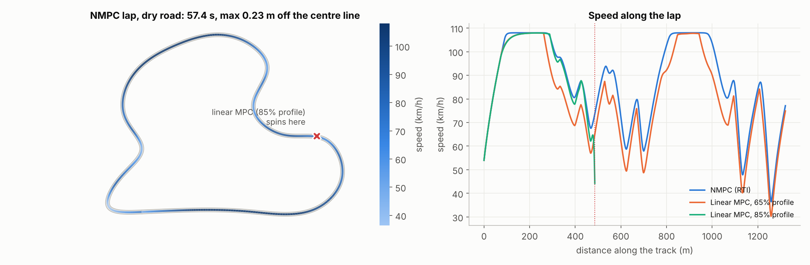
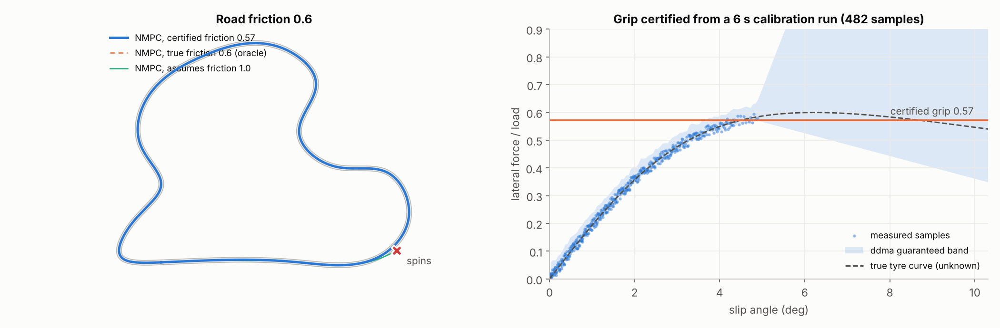
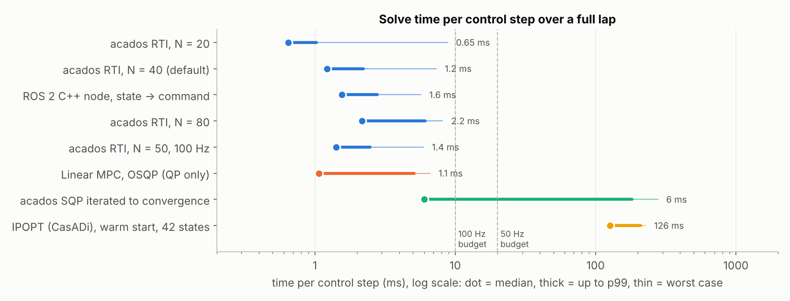

# vehicle-nmpc: real-time nonlinear MPC for a car at the handling limit

A nonlinear model predictive controller that drives a car around a track close to the
tyres' limit. The controller solves its optimisation problem in about a millisecond and
runs as a C++ ROS 2 node. It is compared against the linear MPC used in many production
stacks. On a slippery road it plans with a friction value that is **certified from
data** by [ddma](https://github.com/anas-makdesi/ddma), so it never asks the tyres for
grip the road cannot give.

| | |
|---|---|
| **≈ 1.2 ms** | median solve time per control step (acados, real-time iteration, 40 shooting intervals, 50 Hz); worst case over a lap ≈ 7 ms, no missed deadline |
| **≈ 1.6 ms** | from state message to steering/throttle command in the ROS 2 loop (C++ node, generated solver, no Python) |
| **9 % faster lap** | than the linear-MPC baseline: 57.4 s vs 63.1 s. On the same speed profile the linear MPC spins; it needs a 35 % grip margin to finish |
| **0 spins** | on a road with friction 0.6, planning with the grip ddma certified from a 6 s calibration run (0.57). Planning with the nominal friction spins within 350 m |



## What it does

| 1 · Model | 2 · Optimise in real time | 3 · Know the grip | 4 · Deploy |
|---|---|---|---|
| Dynamic bicycle model in path coordinates, magic-formula tyres, friction circle per axle | acados multiple shooting, exact-Hessian SQP, one real-time iteration per step, HPIPM QP solver, 2 s horizon | ddma turns tyre measurements into a guaranteed lower bound on the road friction | Generated C code inside a ROS 2 C++ node; simulator node; launch test; Docker |

The controller tracks the centre line and a speed profile while respecting:
the road corridor (±2.5 m for the car's centre, soft), a friction ellipse on the total
acceleration, slip angles on the stable side of the tyre peak, per-axle traction and
braking limits, and steering angle and rate limits. Because the model knows that braking
or accelerating reduces the lateral grip of that axle, the controller brakes before a
corner and feeds the throttle in on the exit. A decoupled linear controller cannot do
this, and on the dry-road run that is where it loses the car.

## Results

### Dry road (friction 1.0): NMPC vs linear MPC

Both controllers use the same 2 s horizon, grid, corridor and slip limits. The linear
MPC uses linear tyres (cornering stiffness) along the predicted speed and curvature,
solved by OSQP with warm start, plus a separate speed loop on the track's speed
profile. This is the classic production architecture.

| Controller | Speed profile | Lap time | Max / RMS offset | Result |
|---|---|---|---|---|
| **NMPC, real-time iteration** | 85 % of grip | **57.4 s** | 0.23 / 0.05 m | finishes |
| NMPC, iterated to convergence | 85 % of grip | 57.4 s | 0.24 / 0.05 m | finishes (same lap: RTI gives up nothing here) |
| Linear MPC (OSQP) | 85 % of grip | n/a | n/a | **spins at 486 m** (power oversteer on a corner exit) |
| Linear MPC (OSQP) | 65 % of grip (highest that finishes) | 63.1 s | 0.33 / 0.11 m | finishes |

The NMPC uses at most 89 % of the available friction over the lap.

### Low-grip road (friction 0.6): certified grip

Before driving, the car does a short ramp-steer manoeuvre at 12 m/s on an open pad.
From the measured slip angles and lateral forces (with sensor noise ±0.02), ddma's
`GrowthMap` computes bounds on the tyre curve that hold for *every* curve consistent
with the data and two physical priors: a maximum tyre stiffness, and how fast the force
can drop past the peak. The certified friction is the largest *guaranteed* lateral
force: **0.57** for a true value of 0.6.

| NMPC plans with | Lap time | Max offset | Result |
|---|---|---|---|
| nominal friction 1.0 | n/a | n/a | **spins at 344 m** |
| **ddma-certified friction 0.57** | **72.6 s** | 0.26 m | finishes, never above the true grip |
| true friction 0.6 (oracle) | 71.1 s | 0.17 m | finishes |

Using the certificate costs 2 % of lap time against an oracle that knows the road.



### Timing

All values were measured in closed loop over a full lap (about 2,900 control steps).
They give acados' internal solve time per step. Absolute values depend on the machine;
re-run `examples/benchmark.py` on the target hardware.

| Solver | Median | p99 | Worst | Over 20 ms (50 Hz) | Lap |
|---|---|---|---|---|---|
| acados RTI, N = 20 | 0.65 ms | 1.0 ms | 8.8 ms | 0 % | 57.4 s |
| **acados RTI, N = 40 (default)** | **1.2 ms** | 2.2 ms | 7.3 ms | 0 % | 57.4 s |
| acados RTI, N = 80 | 2.2 ms | 6.1 ms | 8.1 ms | 0 % | 57.4 s |
| acados RTI, N = 50, **100 Hz** | 1.4 ms | 2.5 ms | 5.9 ms | 0 % | 57.4 s |
| ROS 2 C++ node: state → command | 1.6 ms | 2.8 ms | 5.7 ms | 0 % | 57.0 s |
| Linear MPC, OSQP (QP solve only) | 1.1 ms | 5.1 ms | 6.6 ms | 0 % | 63.1 s (65 % profile) |
| acados SQP to convergence | 6.0 ms | 182 ms | 277 ms | 9 % | 57.4 s |
| IPOPT (CasADi), warm start (42 states) | 126 ms | 210 ms | 227 ms | 100 % | n/a |

* **Correctness:** acados and IPOPT, run independently on the same problem, return the
  same first input to within 3·10⁻⁶ of the input range, and the same optimal cost.
* **Warm start matters:** SQP to convergence takes 5 iterations from the previous
  solution and 8 from a cold start.
* **The horizon length, not the number of intervals, sets the lap:** N = 20, 40 and 80
  give the same lap time and offset, so N = 20 would do for this track.
* The linear MPC's QP is as fast as the NMPC step, but building its time-varying matrices
  in Python takes ≈ 7 ms more per step. The NMPC does that work inside the generated C
  code.



## Engineering

* **One problem, three solvers:** acados (production, generated C), CasADi + IPOPT
  (reference), OSQP (linear baseline). Tests check that acados and IPOPT agree.
* **C++ / ROS 2 Jazzy** (`ros2/`):
  * `vehicle_nmpc_msgs`: `FrenetState`, `ControllerStats`.
  * `vehicle_nmpc_ros`:
    * `nmpc_node` runs the generated solver; friction can be changed at run time as a
      parameter, e.g. from a grip estimator. It publishes
      `ackermann_msgs/AckermannDriveStamped` and per-step statistics: solve time,
      latency and status.
    * `sim_node` integrates the car at 1 kHz in real time, so the controller's compute
      and transport delay is part of the loop.
* **Parity tests:** the C++ plant reproduces the Python plant to 10⁻⁹, and the C++
  solver wrapper reproduces the Python controller's inputs over 150 closed-loop steps to
  10⁻⁶. A launch test drives the car for 20 s in real time and checks progress, the
  corridor, solver status and latency.
* **CI** (GitHub Actions): ruff, pytest (with acados built from a pinned commit), and
  `colcon build` plus `colcon test` in a `ros:jazzy` container. **Docker** image with
  everything built.
* Code: `src/vnmpc/`, MIT license.

## Quick start

```bash
# acados (pinned commit) + Python package
scripts/install_acados.sh ~/acados
export ACADOS_SOURCE_DIR=~/acados LD_LIBRARY_PATH=$LD_LIBRARY_PATH:~/acados/lib
pip install -e ".[dev]"
pip install -e ".[grip]"   # ddma v0.12.0, for the grip certificate

python examples/lap_comparison.py   # experiments above -> results/laps.json, figures
python examples/benchmark.py        # timing table -> results/timing.json
pytest -q
```

```python
from vnmpc.params import Vehicle
from vnmpc.track import Track
from vnmpc.nmpc import NMPC, NMPCConfig
from vnmpc.sim import run_lap

veh, track = Vehicle(), Track.default()
ctrl = NMPC(veh, track, NMPCConfig(), mu_model=1.0)
result = run_lap(ctrl, veh, track, mu_true=1.0)
print(result.summary())
```

ROS 2 (Jazzy):

```bash
python scripts/export_c_code.py                 # generated solver for the C++ node
mkdir -p ~/ws && ln -s $PWD/ros2 ~/ws/src && cd ~/ws
colcon build --cmake-args -DCMAKE_BUILD_TYPE=Release && source install/setup.bash
ros2 launch vehicle_nmpc_ros closed_loop.launch.py mu:=0.6 mu_plan:=0.57
python3 src/vehicle_nmpc_ros/scripts/lap_probe.py --length 1321   # lap summary
```

Docker: `docker build -f docker/Dockerfile -t vehicle-nmpc . && docker run --rm -it vehicle-nmpc`.

## Repository layout

```
src/vnmpc/      params, track, model (CasADi + plant), nmpc (acados), ltv_mpc (OSQP),
                reference (IPOPT), grip (ddma certificate), sim, plotting
examples/       lap_comparison.py, benchmark.py
scripts/        install_acados.sh, export_c_code.py, make_cpp_fixtures.py
ros2/           vehicle_nmpc_msgs, vehicle_nmpc_ros (nodes, launch, tests)
results/        JSON outputs of the examples and of the ROS 2 laps
docker/, .github/workflows/
```

## Modelling notes and assumptions

* **What the simulation models.** The plant uses the controller's model family with the
  *true* road friction instead of the planned one, a hard cap on longitudinal force, and
  1 ms integration. The next robustness tests add load transfer, actuator dynamics and
  state-estimation noise.
* **What the grip certificate assumes.** The lateral force depends only on the slip angle
  (one curve for both axles), its slope lies between the stated priors, and measurement
  errors stay within the stated bounds. Only samples with small longitudinal acceleration
  are used, and the remaining force reduction is part of the error bound. Under these
  assumptions the certified value is never above the true friction (tested for 0.4, 0.6
  and 0.8).
* **Timings** vary by about ±30 % between runs on a shared machine. The table gives
  rounded values from one run.

## Next

Load transfer and actuator lag in the plant; online grip updates while driving;
a tube or constraint-tightening variant with a certified error bound; F1TENTH-scale
parameters and a hardware-in-the-loop run.

---
Developed with help from Claude (Anthropic) for code, experiments and documentation.
